# BIPSS 4 — System Documentation

**Build:** v1.0.4 · `com.bipss.app`
**Scope:** every screen, every number on it, where that number comes from, and what is real vs. placeholder.
**Status date:** 6 Sept 2026

This document describes **what the code actually does today**, not what the plan says it should do. Where the two differ, that is called out explicitly. Sections marked **PROPOSAL** are design discussion only — nothing in them is implemented.

---

## Table of contents

1. [Architecture at a glance](#1-architecture-at-a-glance)
2. [The master data journey](#2-the-master-data-journey)
3. [Screen by screen](#3-screen-by-screen)
4. [The risk engine, line by line](#4-the-risk-engine-line-by-line)
5. [Environmental pipeline (and the duplicate-alert bug)](#5-environmental-pipeline)
6. [The AI layer — Coach](#6-the-ai-layer--coach)
7. [BLE deep dive — connection, disconnection, data loss](#7-ble-deep-dive)
8. [Battery percentage from the band — PROPOSAL](#8-battery-percentage-from-the-band--proposal)
9. [Storage model](#9-storage-model)
10. [Theming (short)](#10-theming-short)
11. [Data sharing, backup & restore — PROPOSAL](#11-data-sharing-backup--restore--proposal)
12. [Known gaps register](#12-known-gaps-register)

---

## 1. Architecture at a glance

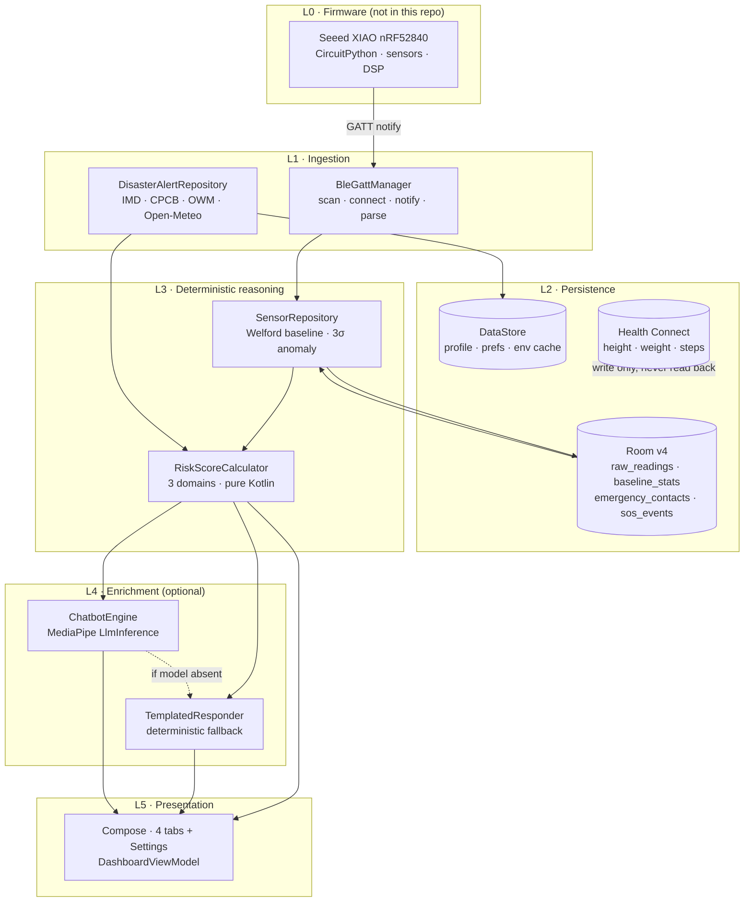

**The critical property:** L5 depends on **L3**, never on L4. If the AI model is absent (which it is today), every screen still renders. The AI is an enrichment layer with a deterministic fallback, not a dependency.

### Module map

| Package | Responsibility |
|---|---|
| `ble/` | `BleGattManager`, `BleConstants` — scan, GATT connect, notification subscribe, byte parse |
| `data/` | `SensorRepository` (baseline math), `UserPreferencesRepository` (DataStore), `connectivityFlow` |
| `data/db/` | Room `AppDatabase` v4, 4 entities, 4 DAOs, 3 migrations |
| `data/environmental/` | `ImdRssParser`, `CpcbAqiFetcher`, `OpenMeteoFetcher`, `OpenWeatherMapFetcher`, `SachetCapFetcher`, `DisasterAlertRepository` |
| `data/repository/` | `HealthConnectRepository` (height/weight/steps only) |
| `data/backup/` | `DriveBackupManager` (partial — see §11) |
| `domain/` | `RiskScoreCalculator`, `RiskScore`, environmental models |
| `ai/` | `ChatbotEngine`, `ModelDownloadManager`, `ModelManifest`, `TemplatedResponder` |
| `sos/` | `SosViewModel`, `LocationHelper`, `SmsSender`, `SosOverlays` |
| `worker/` | `EnvDataSyncWorker` (WorkManager, 3h) |
| `ui/theme/` | Design system — colour tokens, type scale, `BipssColors` extended palette |
| `ui/components/` | `BipssTextField`, `BipssCard`, `RingGauge`, `MetricTile`, `Sparkline`, `ScanPulse`, … |
| `ui/onboarding/`, `ui/dashboard/`, `ui/settings/`, `ui/shell/` | Screens |
| `di/AppModule.kt` | Koin graph — one place where everything is wired |

---

## 2. The master data journey

This is the single most important diagram. It answers "why is that number on screen?"

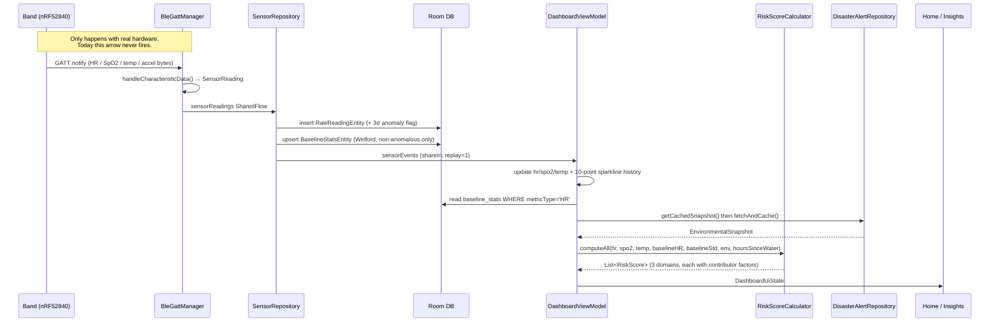

### The substitution rule that explains today's screen

`DashboardViewModel.recomputeRiskScores()` does this **before** calling the calculator:

```kotlin
val currentHR   = s.heartRate.takeIf { it > 0 } ?: 72
val currentSpO2 = s.spO2.takeIf { it > 0 }      ?: 98
val currentTemp = s.skinTempC.takeIf { it > 0f } ?: 36.5f
```

So with no band connected:

- The **vitals tiles** show `—` (the UI checks `> 0` and renders an em-dash), because they read `state.heartRate` directly.
- The **risk scores** are computed from **clinical placeholder values 72 bpm / 98 % / 36.5 °C**, because the calculator was handed defaults.

That is why you can see "Heart rate: —" and "Heat Stress: 84, At risk" on the same screen. They are not contradictory; they are two different code paths, one honest and one substituting. **This substitution is undocumented in the UI and is arguably the single most misleading thing in the app today.** See gap `G-01`.

---

## 3. Screen by screen

### 3.1 Onboarding · Welcome

| Element | Source |
|---|---|
| Everything | Static copy. No data. |

Entry point decided by `MainViewModel`: reads `hasCompletedOnboarding` from DataStore; `false` → `ONBOARDING_WELCOME`, `true` → `DASHBOARD_TODAY`. `MainActivity` shows nothing until `isLoading` clears, so there's no flash of the wrong screen.

### 3.2 Onboarding · Profile ("About you")

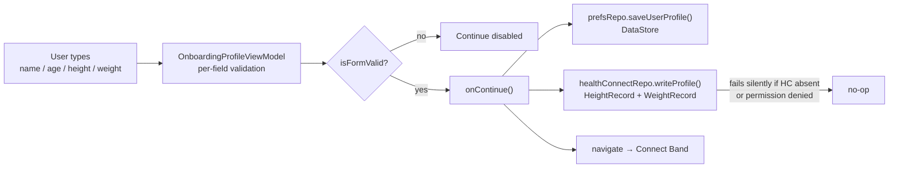

Validation rules (in `OnboardingProfileViewModel`):

| Field | Rule |
|---|---|
| Name | non-blank |
| Age | integer, 1–120 |
| Height | float, 50–250 cm |
| Weight | float, 20–300 kg |

**Health Connect permission** is requested on screen entry via `rememberLauncherForActivityResult` with `PermissionController.createRequestPermissionResultContract()`. If Health Connect isn't installed, `isAvailable()` returns false and the launcher is never fired.

**What height and weight are actually used for:** nothing beyond storage and display. They are written to Health Connect, saved to DataStore, echoed back on Settings → Profile, and included in the Drive backup payload. **No BMI is computed anywhere. Neither value is an input to any risk score.** Confirmed by grep: `heightCm`/`weightKg` appear in exactly 5 files, none of which is `RiskScoreCalculator.kt` or `DashboardViewModel.kt`.

### 3.3 Onboarding · Connect Band

| Element | Source |
|---|---|
| Pulsing radar animation | `ScanPulse` composable — pure animation, not signal strength |
| "Searching for nearby bands…" | `BleConnectionState.Scanning` |
| Device card (name / MAC / dBm) | `BleConnectionState.DeviceFound` — real `ScanResult` |
| "Connected" card | `BleConnectionState.Connected` |
| Continue button enabled | only when `state is Connected` |
| Skip for now | navigates forward without pairing |

Permission requested: `BLUETOOTH_SCAN` + `BLUETOOTH_CONNECT` on API 31+, `ACCESS_FINE_LOCATION` below. Scan starts automatically once granted; `DisposableEffect` stops the scan when leaving the screen.

The scan uses a **`ScanFilter` on `BIPSS_SERVICE_UUID`**, which is currently the standard Heart Rate service UUID `0x180D` used as a placeholder. Until firmware advertises that exact service UUID, **no device will ever be found** — the screen will spin forever. This is expected, not a bug.

On successful connect the screen persists the pairing:

```kotlin
if (state is BleConnectionState.Connected) {
    lastSeen?.let { vm.savePairedDevice(mac = it.address, name = it.name) }
}
```

`lastSeen` is remembered from the preceding `DeviceFound` state, because `Connected` carries no device identity of its own.

### 3.4 Onboarding · AI Model

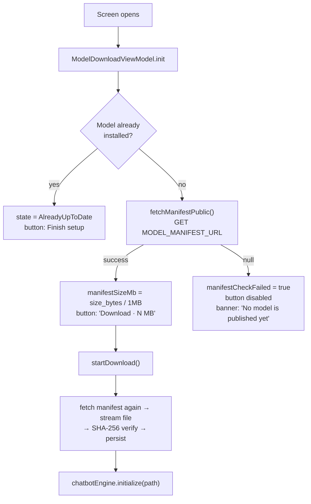

There is **no hardcoded size anywhere**. `MODEL_EXPECTED_SIZE_MB` was removed; `ModelManifest.sizeBytes` has no default value, so a manifest missing `size_bytes` fails to parse rather than silently reporting a fabricated number. Today `MODEL_MANIFEST_URL` still points at `.../REPLACE_ME/REPLACE_ME/main/manifest.json`, so the failure branch is what you see.

Expected `manifest.json` shape:

```json
{
  "version": "1.0.0",
  "url": "https://github.com/<org>/<repo>/releases/download/v1/model.bin",
  "sha256": "abc123…",
  "size_bytes": 262144000
}
```

Download integrity: streamed in 8 KB chunks with live progress + ETA (`bytesDownloaded / elapsed` → seconds remaining), then SHA-256 verified against the manifest. **Mismatch deletes the file** and reports failure — a corrupt model is never kept.

### 3.5 Home ("Today")

| Element | Exact source | Real? |
|---|---|---|
| "Environment synced just now" | `env.dataAgeLabel` — computed from `fetchedAtMs` | ✅ real |
| Mode chip (Live / No band / Offline) | `hasLiveBand = heartRate > 0` × `state.isOnline` | ⚠️ approximation, see below |
| Hero ring score | `riskScores.maxByOrNull { it.score }` | ✅ real math, ⚠️ placeholder inputs |
| Hero band label | `RiskLevel` → Normal / Monitor / At risk | ✅ |
| "What's driving it" pills | `risk.factors` — `RiskFactor(label, isElevated)` | ✅ generated by the calculator |
| Heart rate / SpO₂ / Skin temp tiles | `state.heartRate` etc. — raw BLE values, `—` when 0 | ✅ honest |
| Sparklines | last 10 readings per metric, kept in ViewModel memory only | ✅ (empty today) |
| **Steps tile** | `state.stepCount` — **always 0, nothing ever writes it** | ❌ dead |
| Other risk domains | remaining `riskScores` | ✅ |
| Environment card (temp / humidity / AQI) | `env.*` from the fetch pipeline | ✅ real, live |
| "Showing cached conditions…" banner | `env.isCachedData \|\| env.isStale` | ✅ |
| SOS FAB | triggers `SosViewModel.triggerSos(MANUAL)` | ✅ fully real |

**Mode chip logic** (`DashboardTodayScreen`):

```kotlin
hasLiveBand && isOnline   -> "Live"              (green)
hasLiveBand && !isOnline  -> "Offline · band only" (amber)
!hasLiveBand && isOnline  -> "No band"           (blue-grey)
else                      -> "Offline · cached"  (orange)
```

This mirrors the intent of the plan's 4-state degraded-mode machine, but it is derived ad-hoc in the composable from two booleans. There is no `ConnectivityMonitor`, no shared state machine, and `hasLiveBand` is inferred from "have we ever seen a non-zero heart rate", which stays true forever after the first reading even if the band disconnects. Gap `G-06`.

**Steps:** `HealthConnectRepository.readTodaySteps()` exists and is correct, but **nothing calls it**. `stepCount` is initialised to 0 and never updated. Gap `G-02`.

### 3.6 Insights ("Health")

Three things render here, in order:

**(a) Risk domain cards** — one per `RiskScore`, sorted descending by score. Each shows a 64 dp ring gauge, the band pill, and **all** contributor factors as pills under a "CONTRIBUTORS" divider. This is the explainability surface: the score alone is not actionable, the contributor list is.

**(b) Environment detail card** — a flat `InfoRow` list straight off `EnvironmentalSnapshot`: ambient temp, humidity, UV index, AQI + risk band, dominant pollutant, plus pressure and wind **only if non-null** (they're only populated when OpenWeatherMap is the active source; Open-Meteo doesn't return them).

**(c) Active alerts** — `env.activeAlerts.take(5)`, each an `ImdAlert` from the IMD CAP RSS feed.

#### The duplicate-alert bug (documented, not fixed — as requested)

You're seeing the same alert repeated. There are **four compounding causes**:

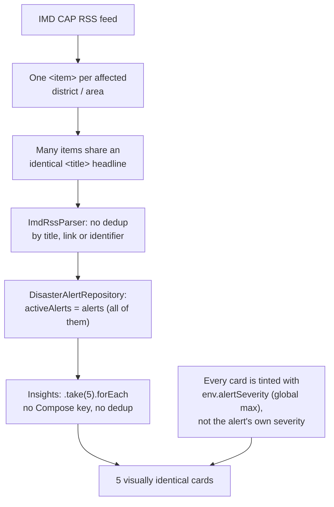

1. **Feed shape.** The IMD CAP feed emits one `<item>` per affected geographic area. A single thunderstorm warning covering 12 districts produces 12 items, all with the same `<title>`.
2. **No deduplication anywhere.** `ImdRssParser.parseRss()` appends every `<item>` unconditionally. `ImdAlert` has no identifier field — only `title`, `description`, `category`, `pubDateMs`, `capXmlUrl` — so there is nothing to dedup on except the title string, and nobody tries.
3. **No geo-filtering.** The plan calls for point-in-polygon matching of the user's location against each alert's `<area><polygon>`/`<geocode>`. The parser doesn't read those elements at all, so alerts for the entire country are shown to every user. This is why irrelevant alerts appear alongside duplicates.
4. **Uniform tinting.** In `DashboardInsightsScreen`, every card uses `accent = env.alertSeverity.color()` — the snapshot's single global max severity — instead of the individual alert's severity. Even genuinely different alerts render the same colour, which amplifies the "it's the same thing five times" impression.

**Additional documented behaviour:** `DisasterAlertRepository.getCachedSnapshot()` sets `activeAlerts = emptyList()`. Only the alert *title* and *severity* are cached to DataStore, not the list. So **alerts disappear entirely when the app reads from cache** (offline, or on cold start before the network fetch completes) and reappear after a successful fetch. Gap `G-07`.

The fix, when you want it: give `ImdAlert` an `identifier`, dedup on `identifier ?: title`, parse `<area>` for geo-matching, store per-alert severity, and cache the alert list properly.

### 3.7 Coach (Chat) — see §6 for the engine

| Element | Source |
|---|---|
| Header pill "Rule-based" / "On-device AI" | `ChatDetailsUiState.aiModelReady` = `chatbotEngine.isModelAvailable`, sampled once in `init` |
| Greeting message | Hardcoded first message in the initial `ChatDetailsUiState` |
| Replies | `ChatbotEngine` if model loaded, else `TemplatedResponder` |

### 3.8 More

| Element | Source |
|---|---|
| Settings card | Navigation only |
| "Network online / Offline" | `connectivityFlow(context)` — real `ConnectivityManager.NetworkCallback` |
| "Environment synced" | `env.dataAgeLabel` |
| "Health status" | `HealthStatus` = max `RiskLevel` across all three domains, mapped Normal/Monitor/At risk |
| "Band: Streaming / Not streaming" | `heartRate > 0` |
| **Risk summary** | `state.riskScores.forEach { InfoRow(displayName, "$score / 100") }` |

The **risk summary has no logic of its own** — it is a flat re-render of the exact same `riskScores` list that drives Home and Insights, formatted as `X / 100`. There is no separate aggregation, weighting, or recalculation. If Home says Heat Stress 84, this says 84.

**Proposed addition — band battery %:** see §8.

### 3.9 Settings

| Section | What's behind it |
|---|---|
| Profile | DataStore `userProfile`; "Edit profile" → `onboarding_profile?editMode=true` (same screen, `isEditMode` hides the step dots and changes the button/nav target) |
| My device | Real `BleGattManager.connectionState` + DataStore `pairedBandMac`/`pairedBandName` |
| AI model | `installedModelVersion` + `installedModelSizeBytes` from DataStore (real manifest size, shown only if known) |
| Appearance | `ThemePreference` ordinal in DataStore |
| Privacy & data | `cloudBackupEnabled` flag, Drive backup/restore, `deletionInitiatedAtMs` countdown |
| Emergency contacts | Room `emergency_contacts` + real `ContactsContract` picker (max 5) |
| About | `BuildConfig.VERSION_NAME` |

#### How Re-pair works

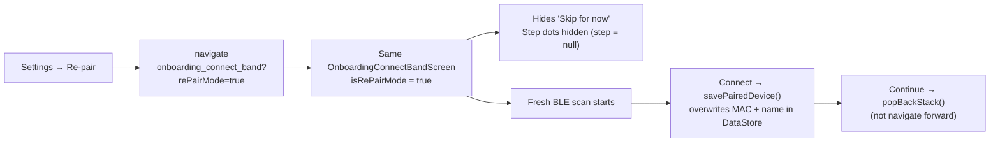

**Forget** is separate: `bleGattManager.disconnect()` (which calls `gatt.disconnect()`, `gatt.close()`, nulls the handle) then `prefsRepo.clearPairedBand()` (removes both DataStore keys). Stored readings in Room are **not** deleted — only the pairing.

Note: neither path calls `BluetoothDevice.createBond()`, so there is no OS-level pairing to remove. "Forget" only clears BIPSS's own record. Gap `G-09`.

### 3.10 SOS overlay

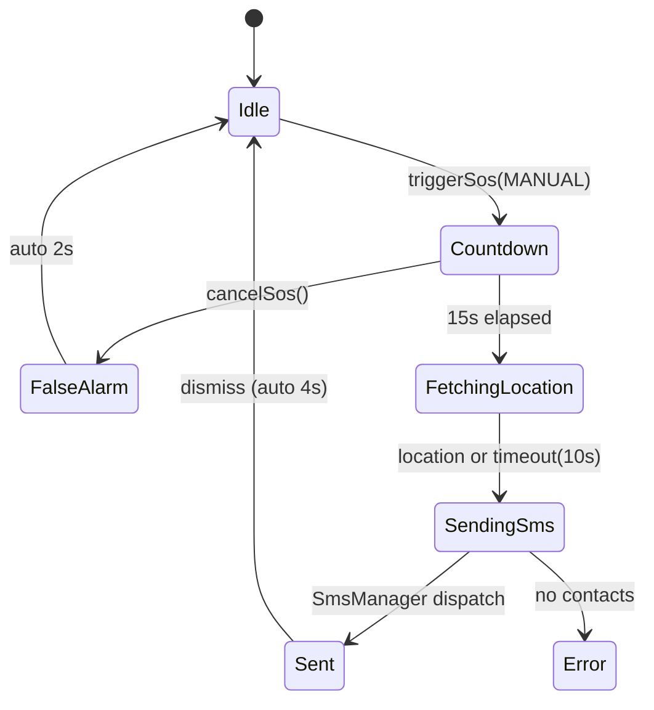

Every terminal state writes a row to Room `sos_events` with outcome `SENT` / `CANCELLED` / `NO_CONTACTS` / `LOCATION_DENIED` / `SEND_FAILED`, plus lat/lng and recipient count. This is a real audit trail.

The SMS body:

```
{name} may have had a fall or medical event at {timestamp}.
Last known location: https://maps.google.com/?q={lat},{lng}.
Automated alert from BIPSS.
```

Messages over 160 chars are split with `divideMessage` + `sendMultipartTextMessage`. Location uses `PRIORITY_HIGH_ACCURACY` with a 10 s timeout; on timeout it still sends, with "location unavailable" and outcome `LOCATION_DENIED`.

**Fall detection does not exist.** `SosTriggerSource.FALL_DETECTION_ML` is declared in the enum with an integration sketch in `SosConstants.kt`, but nothing produces it. Only the manual FAB fires SOS. Gap `G-10`.

---

## 4. The risk engine, line by line

`RiskScoreCalculator` is pure Kotlin, zero Android imports, fully unit-testable. It computes three domains. Every score is clamped 0–100 and mapped to a band: `<20 LOW`, `<50 MEDIUM`, `≥50 HIGH`.

### 4.1 Heat Stress — 100 points

| Component | Formula | Max |
|---|---|---|
| `base` | `(0.7 × humidityFactor + 0.3 × tempFactor) × 50`<br/>where `tempFactor = ((ambientC − 20) / 20).coerceIn(0,1)`<br/>and `humidityFactor = (humidity% / 100).coerceIn(0,1)` | 50 |
| `hrMod` | `((HR − 70) / 30).coerceIn(0,1) × 20` | 20 |
| `dehydMod` | `(hoursSinceWater.coerceIn(0,8) / 8) × 20` | 20 |
| `skinMod` | `((skinTempC − 36.5) / 1.5).coerceIn(0,1) × 10` | 10 |
| `alertBoost` | EXTREME 25 · WARNING 15 · WATCH 8 · ADVISORY 3 · NONE 0 | 25 |

Humidity is weighted more than temperature (0.7 vs 0.3) because evaporative cooling failure — not absolute temperature — is what drives heat illness.

**Worked example — the exact 84 you saw on screen:**

| Input | Value | Source |
|---|---|---|
| ambientTempC | 25 | live, Open-Meteo |
| humidity | 97 % | live, Open-Meteo |
| heartRate | 72 | **placeholder default** (no band) |
| skinTempC | 36.5 | **placeholder default** |
| hoursSinceWater | 8.0 | **default — never logged, see below** |
| alertSeverity | EXTREME | live, IMD feed |

```
tempFactor     = (25 − 20) / 20            = 0.25
humidityFactor = 97 / 100                  = 0.97
base           = (0.7×0.97 + 0.3×0.25)×50  = 37.70
hrMod          = ((72−70)/30) × 20         =  1.33
dehydMod       = (8/8) × 20                = 20.00
skinMod        = ((36.5−36.5)/1.5) × 10    =  0.00
alertBoost     = EXTREME                   = 25.00
                                             ──────
                                     total  = 84.03 → 84  ✓
```

**The hydration problem.** `hoursSinceLastWaterLog()` returns `8f` when the user has never logged water. `logWaterIntake()` exists in `UserPreferencesRepository`, and `ChatDetailsViewModel.logWater()` exists — but **no UI anywhere calls it**. So `dehydMod` is permanently pinned at its maximum 20/20. One fifth of the heat-stress score is a constant. Gap `G-03`.

### 4.2 Respiratory — 100 points

| Component | Formula | Max |
|---|---|---|
| `spo2Score` | `((100 − SpO₂) × 10).coerceIn(0,80)` | 80 |
| `breathProxy` | `(((HR / SpO₂) − 0.7) / 0.3 × 20).coerceIn(0,20)` | 20 |
| `aqiScore` | SEVERE 30 · VERY_POOR 22 · POOR 15 · MODERATE 8 · else 0 | 30 |

Note the sum can exceed 100 before clamping. `breathProxy` is a crude stand-in for respiratory rate — the band has no respiration sensor, so HR/SpO₂ ratio is used as a proxy.

**Worked example — the 30 you saw:**
```
spo2Score   = (100 − 98) × 10        = 20.00   (SpO₂ = placeholder 98)
breathProxy = ((72/98 − 0.7)/0.3)×20 =  2.31
aqiScore    = MODERATE               =  8.00
                                       ──────
                               total  = 30.31 → 30  ✓
```

**Documented inconsistency:** the AQI *value* and AQI *risk band* can disagree. In `DisasterAlertRepository.fetchAndCache()`:

```kotlin
aqiValue     = aqiSnapshot?.aqiValue  ?: 80                    // → maps to SATISFACTORY
aqiRiskLevel = aqiSnapshot?.riskLevel ?: AqiRiskLevel.MODERATE // → hardcoded MODERATE
```

With no CPCB key, the value falls back to 80 (SATISFACTORY band) but the level falls back to MODERATE independently. `getCachedSnapshot()` meanwhile *derives* the level correctly via `AqiRiskLevel.fromAqi(80)` → SATISFACTORY. So Insights can display "80 · satisfactory" while the risk engine simultaneously charges 8 points for MODERATE. Gap `G-04`.

### 4.3 Cardiovascular — 100 points

| Component | Formula | Max |
|---|---|---|
| `sigmaScore` | `(σ.coerceIn(0,2) / 2) × 60` where `σ = (HR − baselineHR) / baselineStdDev` | 60 |
| `tachycardiaAdd` | `+30` if HR > 100 | 30 |

**Why this shows 0/100 today:** `DashboardViewModel` reads the HR baseline from Room:

```kotlin
val baseStats     = sensorRepo.baselineStatsDao.getByType("HR")
val baselineHR    = baseStats?.mean   ?: currentHR.toDouble()   // ← falls back to *itself*
val baselineHRStd = baseStats?.stdDev ?: 5.0
```

With no readings, `baseline_stats` is empty, so `baselineHR` becomes `currentHR` — the same placeholder 72. Therefore `σ = (72 − 72) / 5 = 0`, `sigmaScore = 0`, and 72 is not > 100, so the score is exactly 0. This is deterministic, not a coincidence.

### 4.4 How baselines are actually built

`SensorRepository.updateMetric()` runs on every incoming reading, per metric type (`HR`, `SPO2`, `SKIN_TEMP`, `ACCEL_X/Y/Z`):

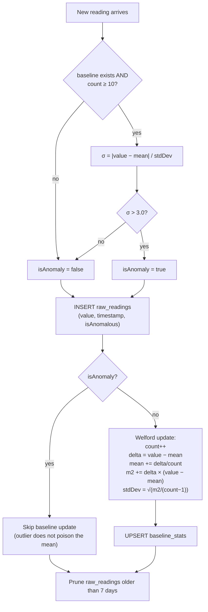

**Welford's online algorithm** computes a running mean and variance in a single pass without storing history — important because this runs at sensor rate. Constants: `BASELINE_MIN_READINGS = 10`, `ANOMALY_THRESHOLD_SIGMA = 3.0`, retention 7 days.

**Divergence from the plan:** the plan specifies **median + MAD** with robust z-scores (`z = 0.6745 × (x − median) / MAD`), context partitioning (REST / SLEEP / ACTIVE), and population priors blended over the first 30 days. What exists is mean + standard deviation, unpartitioned, with no priors. Mean/SD is not robust to the motion artefacts wearable PPG is full of — a handful of bad samples in the first 10 readings will permanently skew the baseline, because those first 10 are accepted unconditionally (the anomaly gate only activates at `count ≥ 10`). Gap `G-05`.

**Only HR is ever read back.** `SPO2`, `SKIN_TEMP` and the three accel axes have baselines computed and stored, but nothing queries them. Only `getByType("HR")` is called.

---

## 5. Environmental pipeline

### 5.1 Sources and fallback order

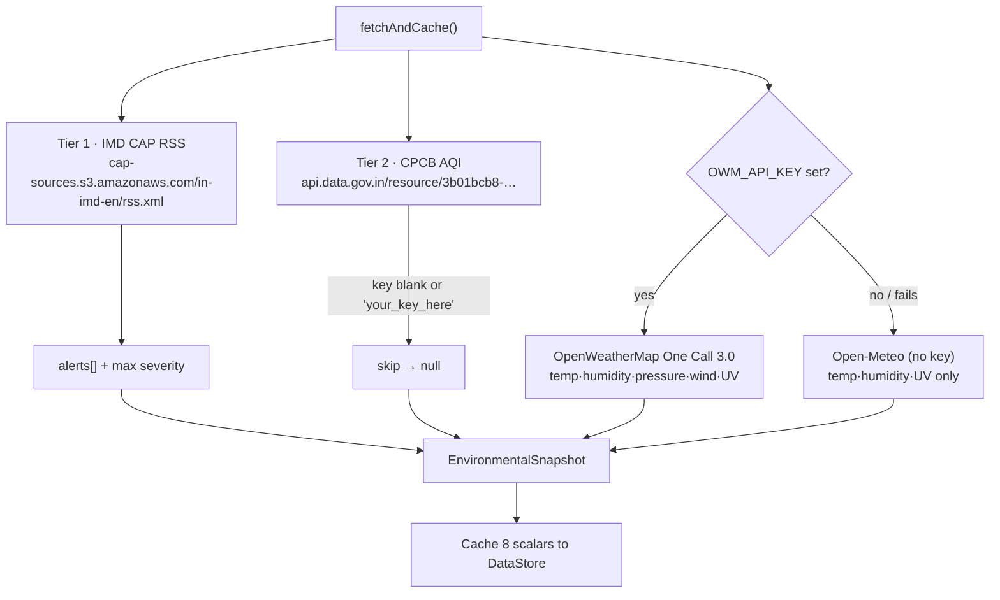

| Source | Auth | Status today |
|---|---|---|
| IMD CAP RSS | none | ✅ working |
| Open-Meteo | none | ✅ working |
| CPCB AQI (`data.gov.in`) | API key | ⏸️ skipped, key is `your_key_here` |
| OpenWeatherMap One Call 3.0 | API key **+ separate "One Call by Call" subscription** | ⏸️ skipped |
| Sachet / NDMA | none | ❌ written but never called (needs a bulk-list endpoint) |

**Refresh cadence:** `EnvDataSyncWorker`, `PeriodicWorkRequest` every **3 hours**, network-constrained, exponential backoff from 15 min, `ExistingPeriodicWorkPolicy.KEEP`. Plus an opportunistic fetch on every `DashboardViewModel` init. The plan calls for 5 min foreground / 15 min background with a 15-row FIFO ring buffer; neither exists. Gap `G-08`.

**Caching:** only 8 scalars go to DataStore (`temp, humidity, uvIndex, aqiValue, aqiPollutant, alertTitle, alertSeverity, fetchedAtMs`). Pressure, wind, and the alert *list* are not cached. `STALE_THRESHOLD_MS = 2 hours`; beyond that `isStale = true` and the UI switches to cached-language.

There is **no trend extrapolation**. The plan's linear regression over 15 slots, pressure-tendency rule, and sensor-anchored correction do not exist — offline simply shows the last cached values with an age stamp.

---

## 6. The AI layer — Coach

### 6.1 The availability contract

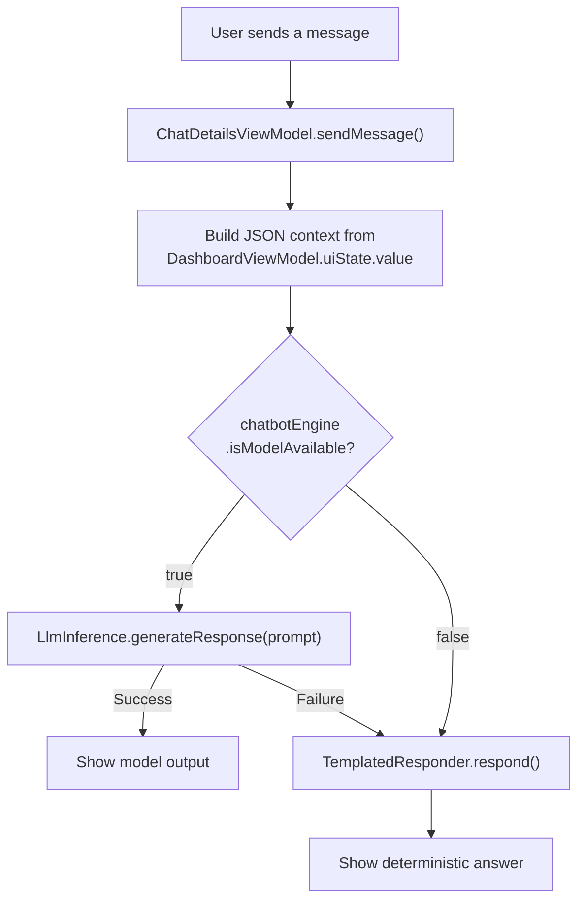

`isModelAvailable` is simply `llmInference != null` — it only becomes true after `initialize(modelPath)` succeeds, which only happens after a verified download. Today it is always false, so **every reply comes from `TemplatedResponder`**, and the header pill honestly reads "Rule-based".

### 6.2 The prompt actually sent to the model

```kotlin
val contextJson = """{"heartRate":72,"spO2":98,"skinTempC":36.5,
                      "ambientTempC":25.0,"aqiValue":80,
                      "scores":[{"type":"Heat Stress","score":84,"level":"HIGH"}, …]}"""
val prompt = "Context: $contextJson\nUser: $question\nAssistant:"
```

The model never sees raw sensor streams — only current values plus the rule engine's verdicts. **However, none of the plan's safety guardrails are implemented:** there is no system prompt, no "never contradict the rule engine's band" instruction, no constraint keeping replies to plain, non-clinical language, no output length cap, and critically **no post-generation validation** that the model's answer agrees with `RiskAssessment.band`. A 270M model will drift; nothing currently stops it from talking a user down from AT_RISK. Gap `G-11`.

### 6.3 Runtime — GPU vs CPU

```kotlin
LlmInference.LlmInferenceOptions.builder()
    .setModelPath(modelPath)
    .setMaxTokens(1024)
    .setTemperature(0.7f)
    .build()
```

**No backend is specified.** MediaPipe's `LlmInference` chooses its own default delegate. In the current `tasks-genai` builds that means it will attempt **GPU** where the device exposes a usable OpenCL/Vulkan path and the model was converted for it, and fall back to **CPU (XNNPACK)** otherwise. The important consequences:

- The choice is **implicit and unverified** — we have never run this on real hardware, so we don't actually know which path a given phone takes.
- A `.task`/`.bin` bundle is compiled for a target backend at conversion time. If the bundle is CPU-only and the runtime tries GPU (or vice versa), initialisation throws — which is caught, sets `chatbotEngineFailed`, and silently falls back to templates. The user would just see "Rule-based" forever with no explanation.
- `setMaxTokens(1024)` is the total context window (prompt + response), not a response cap.
- Inference runs on `Dispatchers.IO`, so the UI thread is safe, but there is **no streaming** — `generateResponse()` blocks until the full string is ready, then the whole message appears at once. The "Thinking…" bubble covers this.

If you want deterministic behaviour, `LlmInferenceOptions` should explicitly set the preferred backend and the app should surface which one is in use in Settings → AI model. Gap `G-12`.

### 6.4 The deterministic fallback

`TemplatedResponder.respond()` is a priority-ordered keyword matcher over the live `riskScores` list:

| Priority | Trigger | Response |
|---|---|---|
| 1 | (`why` \| `reason` \| `cause`) + a domain name | "Your {domain} score of {N} is driven by: {factor list}." |
| 2 | (`what` \| `score`) + a domain name | "Your {domain} score is currently {N} ({band})." |
| 3 | `heart` \| ` hr` \| `bpm` | "Your current heart rate is {N} bpm." |
| 4 | `spo2` \| `oxygen` \| `saturation` | "Your blood oxygen saturation is currently {N}%." |
| 5 | `temp` \| `temperature` | "Your skin temperature is {N}°C." |
| 6 | `all` \| `overview` \| `summary` | All three scores, joined. |
| 7 | *(default)* | Current HR / SpO₂ / temp + "ask me about a specific score". |

It substitutes the **same placeholder values** the risk engine uses, so with no band it will confidently tell you your heart rate is 72 bpm. Gap `G-01` again.

---

## 7. BLE deep dive

### 7.1 What the code does today

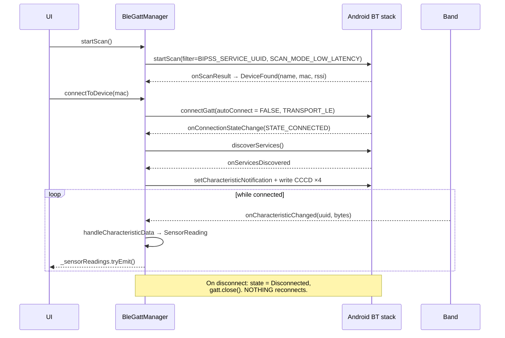

### 7.2 Answering your questions directly

> **"How does the BLE from the physical sensor connect to our app and stay connected indefinitely?"**

**It doesn't stay connected.** Today:

- `connectGatt(context, autoConnect = false, …)` — `false` means *direct connect, fail fast, never retry*. Android's auto-reconnect mechanism (`autoConnect = true`, which registers a background connection request the OS honours whenever the device comes back in range) is **not used**.
- On `STATE_DISCONNECTED` the manager sets state to `Disconnected` and calls `gatt.close()`. There is no retry loop, no backoff, no reconnection at all. The only way back is the user tapping **Reconnect** or **Re-pair** in Settings.
- There is **no foreground service**. `BleGattManager` is a Koin `single` owned by the `Application` object. On Android 13+, once the app goes to background the process becomes a candidate for termination within minutes — and when the process dies, the GATT connection dies with it.
- There is **no bonding**. `createBond()` is never called, so the link has no LE Secure Connections encryption. Data is transmitted in the clear.
- No `requestMtu()`, no `requestConnectionPriority()`, no PHY request. Default MTU is 23 bytes (20 usable), and the default connection interval is whatever the peripheral proposes.

> **"If the phone gets switched off or Bluetooth gets turned off, what happens to the data — lost, or stored on the Seeed board?"**

**From the app's perspective: completely lost.** There is no store-and-forward of any kind:

- The band has no way to tell the app "here are the 400 samples you missed" because there is no sequence number, no catch-up protocol, and no request for historical data.
- Worse, and this is the part that would bite you even if you *did* add board-side buffering today: **the app timestamps every reading at the moment it arrives on the phone**, not at the moment it was measured on the band:

  ```kotlin
  rawReadingDao.insert(RawReadingEntity(
      metricType  = type,
      value       = value,
      timestampMs = System.currentTimeMillis(),   // ← arrival time, not sample time
      isAnomalous = isAnomaly
  ))
  ```

  If the firmware replayed an hour of buffered samples on reconnect, all of them would be stamped with the replay instant. The Room table would show 3,600 readings that all happened "now", the Welford baseline would ingest them as if they were simultaneous, and any future sleep-staging or trend analysis over that window would be garbage.

Whether data survives on the **board** is a firmware question and depends entirely on what you write there — the nRF52840 has 1 MB flash / 256 KB RAM and the XIAO adds 2 MB QSPI flash, so buffering hours of feature-level data is very feasible. But the app currently offers no protocol to retrieve it.

### 7.3 Recommendations — data handling across the BLE boundary

You described the pipeline as: sensors give waveform data → CircuitPython on the board converts it to values → sends to phone → app processes locally. That split is correct, and here is how I'd tighten it.

**1. Never stream raw waveforms.** A 25 Hz 3-axis accelerometer at int16 is 150 B/s; a raw PPG waveform at 100 Hz is worse. Over BLE with a 23-byte MTU that is constant radio airtime and it will dominate the band's power budget. Keep doing the DSP on-board and send **features**: heart rate, pulse-rate variability (PRV, RMSSD), SpO₂, skin temp, and *activity counts* (band-passed accel magnitude summed per 30 s epoch) rather than raw axes. The one exception: keep raw accel available on demand for a short window if you later want fall-detection model input.

**2. Add a sequence number and a band uptime counter to every frame.**

```
struct SensorFrame {          // packed little-endian, ~24 B
    uint32 seq;               // monotonic, survives across connections
    uint32 band_uptime_ms;    // since boot
    int16  hr;                // -1 = invalid
    int16  hrv_rmssd;
    int16  spo2;
    int16  skin_temp_c_x100;
    int16  amb_temp_c_x100;
    int16  humidity_pct_x100;
    int16  aqi_raw;
    uint8  battery_pct;
    uint8  quality_bitmask;   // which sensors were valid this frame
}
```

The `quality` bitmask matters: it lets the app distinguish "SpO₂ is 0 because the sensor lost contact" from "SpO₂ is genuinely low", which is the difference between a false alarm and a real one.

**3. Establish a clock offset once per connection, then convert.** On connect the phone reads `band_uptime_ms` and records `offset = wallClockNow − bandUptime`. Every subsequent frame's true timestamp is `frame.band_uptime_ms + offset`. Persist *that* into `RawReadingEntity.timestampMs` instead of `System.currentTimeMillis()`. This single change makes buffered replay correct.

**4. Board-side ring buffer + gap-fill protocol.** Reserve a chunk of the XIAO's QSPI flash as a circular buffer of frames. Add a small control characteristic where the phone writes "last seq I have = N"; the band then streams everything after N before resuming live data. Size it for the realistic worst case — an overnight disconnect at 1 Hz is ~86 k frames × 24 B ≈ 2 MB, so either drop to one frame per 30 s when the phone is absent, or accept a shorter buffer window and document the loss.

**5. On the app side, the three changes that matter most:**
   - `autoConnect = true` for the reconnect path (slower first connect, but the OS reconnects for you whenever the band reappears).
   - A **foreground service** holding the connection, with a persistent notification. Without it Android 13+ will kill you.
   - `createBond()` for LE Secure Connections, so the link is actually encrypted and the pairing survives reboots.

**6. On CircuitPython specifically.** It is excellent for getting sensors talking quickly, but be aware of what you're trading: the garbage collector introduces non-deterministic pauses (bad for consistent PPG sampling intervals), and its BLE throughput is well below what the nRF52840 can do natively. If the DSP stays lightweight — peak detection for HR, ratio-of-ratios for SpO₂, band-pass + magnitude for activity counts — CircuitPython will hold up at 1 Hz output. If you later need continuous 25 Hz accelerometer streaming for fall detection, plan on moving that path to the Nordic SDK or Zephyr. Prototype in CircuitPython, port the hot path if measurements demand it.

---

## 8. Battery percentage from the band — PROPOSAL

**Nothing here is implemented.** This is a design note for when you want it.

Your hardware description is accurate: the XIAO nRF52840 routes battery voltage through an on-board divider into the nRF52840 SAADC on **P0.31 (AIN7)**, with a BQ25101 handling USB charging. The firmware steps you outlined (configure analog pin → map voltage to percentage → expose via BLE Battery Service → notify) are exactly right. Two hardware caveats worth verifying on your board revision before you write the firmware:

- Several XIAO nRF52840 revisions gate the divider behind a **read-enable pin (P0.14)** that must be driven **LOW** to connect the divider before sampling, and returned HIGH afterwards to stop the divider drawing current continuously. Check your schematic — if it applies and you skip it, you'll read noise.
- **Li-Po voltage → state-of-charge is strongly non-linear.** A linear map from 4.2 V→100 % and 3.3 V→0 % will read ~50 % for most of the discharge curve and then collapse. Use a lookup table with more points in the 3.7–3.9 V plateau. Also note that **while charging, the terminal voltage is inflated** — a battery reading 4.1 V on USB may be at 60 % actual charge — so expose a charging flag and either suppress or annotate the percentage while plugged in.

### App-side integration sketch

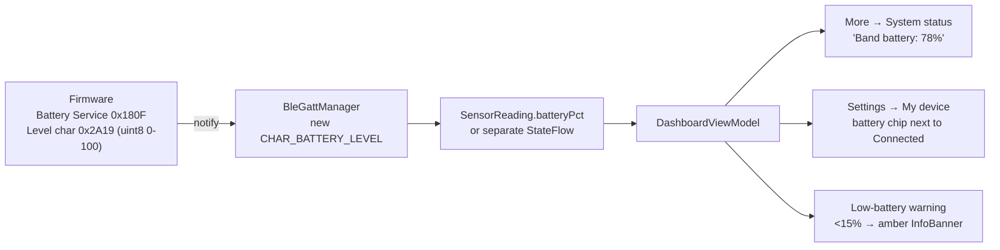

Concretely on the app side that is:

1. Add `CHAR_BATTERY_LEVEL = 0x2A19` and `BATTERY_SERVICE = 0x180F` to `BleConstants`. Note the Battery Service is a **separate GATT service** from your custom sensor service, so `enableNotification()` — which currently hardcodes `gatt.getService(BIPSS_SERVICE_UUID)` — needs to take the service UUID as a parameter.
2. Parse in `handleCharacteristicData()`: a single unsigned byte, `value[0].toInt() and 0xFF`.
3. Surface it. I'd keep it *out* of `SensorReading` (which represents a physiological sample and gets persisted to `raw_readings`) and expose a separate `batteryPercent: StateFlow<Int?>` on `BleGattManager` — battery is device telemetry, not health data, and shouldn't pollute the readings table or the baseline math.
4. Display in **More → System status** (as you suggested) and in **Settings → My device**. A low-battery banner under 15 % is worth it, since a dead band means silent loss of monitoring.

---

## 9. Storage model

| Data | Store | Retention | Encrypted? |
|---|---|---|---|
| Raw readings (HR, SpO₂, temp, accel ×3) | Room `raw_readings` | **7 days**, pruned on every write | ❌ plain SQLite |
| Per-metric baselines (Welford) | Room `baseline_stats` | indefinite | ❌ |
| Emergency contacts | Room `emergency_contacts` | indefinite | ❌ |
| SOS audit log | Room `sos_events` | last 50 read back | ❌ |
| Profile, prefs, env cache, model metadata | DataStore Preferences | indefinite | ❌ |
| Height, weight | Health Connect | permanent, survives uninstall | ✅ by platform |
| Heart rate, SpO₂, skin temp | **Room only — deliberately not in Health Connect** | 7 days | ❌ |

Room schema is at **version 4** with three migrations (`1→2` readings + baselines, `2→3` contacts, `3→4` SOS events).

The plan calls for SQLCipher + Android Keystore and EncryptedSharedPreferences for keys/contacts. Neither is implemented — everything is plaintext on disk. On a rooted or backed-up device, `raw_readings` and `emergency_contacts` are readable. Gap `G-13`.

---

## 10. Theming (short)

```
DataStore (int ordinal)
  → SettingsViewModel.themePreference : StateFlow<ThemePreference>
    → MainActivity collects it
      → BipssTheme(themePreference) {
           darkTheme = SYSTEM ? isSystemInDarkTheme() : (pref == DARK)
           colorScheme = darkTheme ? DarkScheme : LightScheme      // Material tokens
           extended    = darkTheme ? DarkExtended : LightExtended  // BipssColors
           → CompositionLocalProvider(LocalBipssColors) { MaterialTheme { … } }
        }
```

Two parallel palettes: Material's `ColorScheme` for standard components, and a custom `BipssColors` (surface ladder, risk bands, per-vital tints) provided via `CompositionLocal` and read as `BipssTheme.colors.*`. Selecting a radio in Settings writes the ordinal to DataStore, the flow re-emits, `MainActivity` recomposes, and the whole tree re-themes. Status/navigation bar colours are updated in a `SideEffect`.

---

## 11. Data sharing, backup & restore — PROPOSAL

**Current state is wrong and needs restructuring.** Today there is a single "Cloud backup" toggle whose subtitle says "Settings, baselines and contacts only — raw sensor data never leaves the device", wired to a partially-built `DriveBackupManager`. That conflates two features that you have described as separate, and the copy implies research sharing while the code does personal backup. Neither is finished.

Here is the target design as you specified it.

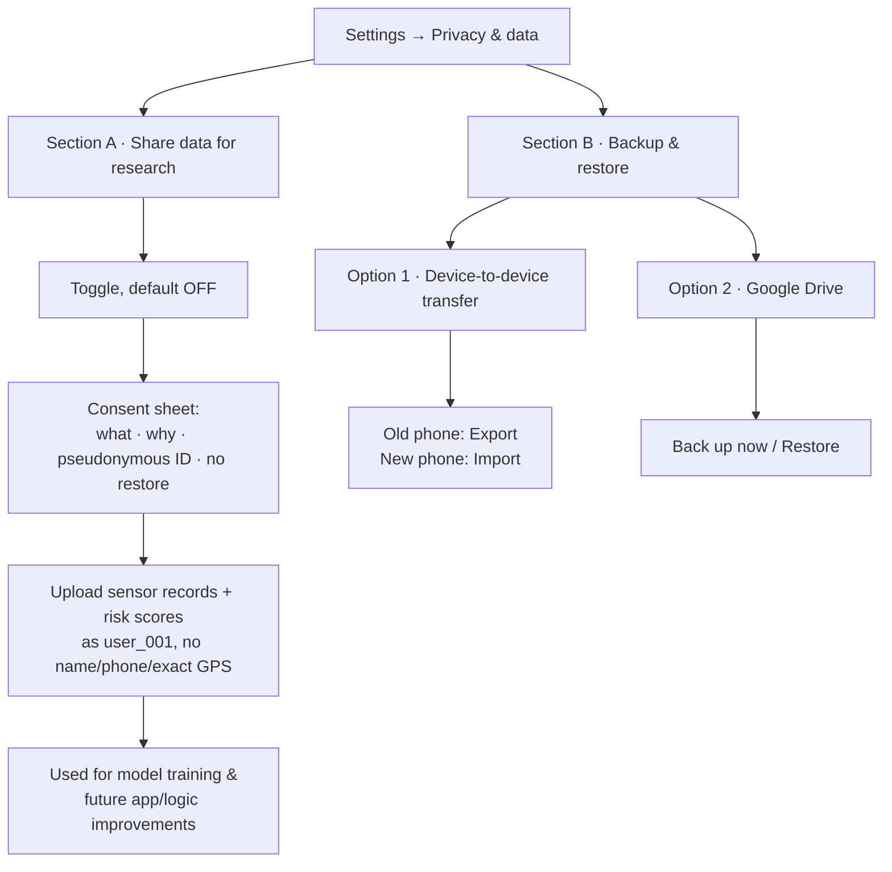

### 11.1 Section A — Share data with us (research / training)

- **Purpose:** improve our models and logic. Shipped back to the user as better app versions, not as a restore path.
- **Default:** OFF. Never pre-ticked.
- **Identity:** pseudonymous only — `user_001` style opaque ID generated on first opt-in, stored locally. **No** name, phone number, or precise GPS. Location, if sent at all, coarsened to roughly a 5 km grid.
- **Payload:** sensor records and computed risk scores. This is the one place raw readings legitimately leave the device — and only on explicit opt-in.
- **Explicitly not a backup.** There is no restore from this. It must say so on the consent sheet, because users will otherwise assume "my data is in the cloud" means "I can get it back".
- **Transport:** WorkManager job with `requiresBatteryNotLow` + `NetworkType.UNMETERED`. Never on cellular.

**Deletion semantics — say this plainly in the UI:**

> Turning sharing off stops all collection immediately and deletes your stored records within 7 days. Models that were already trained using your data cannot be untrained — that data is already absorbed into model weights and is not recoverable or removable. Nothing that identifies you is stored either way.

That is honest and it is defensible. The 7-day window exists so the user can change their mind (matching the existing `deletionInitiatedAtMs` countdown already in `UserPreferencesRepository`).

### 11.2 Section B — Backup & restore (the user's own data)

Two independent options, both user-initiated, neither automatic.

#### Option 1 — Device-to-device transfer (does not exist)

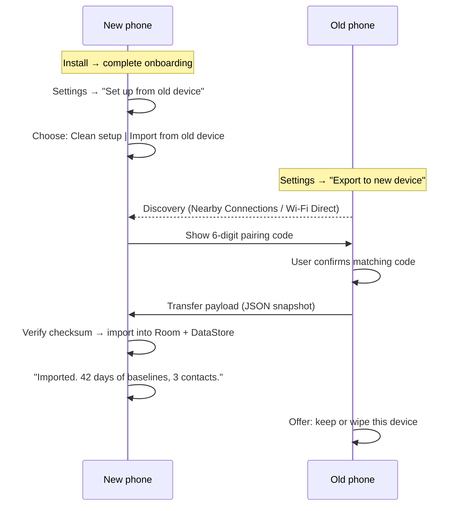

**Recommended transport: Google's Nearby Connections API** (`P2P_POINT_TO_POINT` strategy). It negotiates Bluetooth / BLE / Wi-Fi Direct / hotspot automatically, handles the bandwidth upgrade, and works without either device having internet. Building raw Wi-Fi Direct or a Bluetooth RFCOMM socket by hand is possible but you'd be reimplementing what Nearby already solved, including the awkward parts (discovery timeouts, Android version differences, permission dances).

**Payload:** the same JSON snapshot the Drive path uses — profile, theme and privacy prefs, emergency contacts, baseline stats, SOS audit log. Raw readings excluded (7-day window, large, low value). Include a schema version so a newer app can import from an older one.

**Safety:** the pairing code must be confirmed on **both** screens before transfer starts, otherwise you have a device in the room silently pulling someone's emergency contacts. Never auto-accept.

#### Option 2 — Google Drive (partially built)

One button to back up, one to restore. Uses Drive's `appDataFolder` — a hidden per-app space that is invisible in the user's normal Drive UI and unreadable by any other app, so it solves migration without exposing the data.

`DriveBackupManager` already implements: Google Sign-In scoped to `drive.appdata` only, OAuth token via `GoogleAuthUtil`, Drive v3 REST (list / multipart create / media update / download), and JSON serialisation of the payload. **It cannot work until an OAuth 2.0 client ID is registered** in Google Cloud Console against `com.bipss.app` plus the signing certificate SHA-1. Until then sign-in launches but the scope grant fails.

### 11.3 Migration path from today's UI

| Today | Should become |
|---|---|
| "Cloud backup" toggle | **Section A** toggle, relabelled "Share data for research", with the consent sheet |
| "Back up now" / "Restore" buttons | Move to **Section B → Google Drive** |
| — | New: **Section B → Transfer to/from another device** |
| "Delete my data" | Split: "Delete local data" (wipes Room + DataStore) vs "Stop sharing & delete my records" (the 7-day server flow) |

The existing 7-day `deletionInitiatedAtMs` countdown belongs to Section A, not to local deletion — local deletion should be immediate.

---

## 12. Known gaps register

| ID | Gap | Impact | Where |
|---|---|---|---|
| **G-01** | Risk scores silently substitute HR 72 / SpO₂ 98 / temp 36.5 when no band is connected; UI gives no indication | **High** — app shows confident scores built on fabricated vitals; Coach states them as fact | `DashboardViewModel.recomputeRiskScores()` |
| **G-02** | `stepCount` never populated; `readTodaySteps()` never called | Medium — Steps tile permanently `—` | `DashboardViewModel`, `HealthConnectRepository` |
| **G-03** | No water-logging UI; `hoursSinceLastWaterLog` pinned at 8 h | Medium — 20/100 heat-stress points are a constant | `ChatDetailsViewModel.logWater()` unused |
| **G-04** | AQI value and AQI risk band fall back independently (80 → SATISFACTORY vs hardcoded MODERATE) | Medium — Insights and the engine disagree | `DisasterAlertRepository.fetchAndCache()` |
| **G-05** | Baselines use mean+SD, not median+MAD; no context partitioning, no population priors; first 10 readings accepted unfiltered | Medium — artefacts permanently skew baselines | `SensorRepository.updateMetric()` |
| **G-06** | Degraded-mode is ad-hoc in the composable, not a state machine; `hasLiveBand` never returns to false | Low–Medium | `DashboardTodayScreen` |
| **G-07** | Alerts duplicated (no dedup, no geo-filter, uniform tint) and vanish entirely when reading from cache | Medium | `ImdRssParser`, `DisasterAlertRepository`, `DashboardInsightsScreen` |
| **G-08** | Env refresh is 3 h, not 5/15 min; no 15-slot ring buffer; no offline extrapolation | Medium | `EnvDataSyncWorker` |
| **G-09** | No BLE bonding (`createBond()` never called) — link unencrypted; "Forget" only clears app-side record | **High** (privacy) | `BleGattManager` |
| **G-10** | Fall detection does not exist; only manual SOS | Medium | `SosConstants` |
| **G-11** | No system prompt, no safety constraints, no post-generation band validation for the LLM | **High** (safety) | `ChatDetailsViewModel.generateResponse()` |
| **G-12** | MediaPipe backend (GPU/CPU) unspecified and unverified; init failure falls back silently | Medium | `ChatbotEngine.initialize()` |
| **G-13** | No SQLCipher/Keystore; Room and DataStore are plaintext | **High** (privacy) | storage layer |
| **G-14** | No BLE reconnection (`autoConnect=false`, no retry), no foreground service | **High** — connection cannot survive backgrounding | `BleGattManager`, missing service |
| **G-15** | Readings timestamped on arrival, not on the band — buffered replay would corrupt the timeline | **High** — blocks any store-and-forward design | `SensorRepository.updateMetric()` |
| **G-16** | Height/weight collected but unused; no BMI anywhere | Low | `RiskScoreCalculator` |
| **G-17** | Sleep and Flood risk domains not implemented (3 of the planned 5) | Medium | `RiskScoreType` |
| **G-18** | Sharing vs backup conflated in one toggle; P2P transfer absent; Drive blocked on OAuth client ID | Medium | §11 |
| **G-19** | Unified `SensorFrame` / `EnvFrame` / `RiskAssessment` contracts (with `confidence` and `dataMode`) not implemented | **High** — firmware is blocked on this | `domain/` |
| **G-20** | BLE service and characteristic UUIDs are placeholders (`0x180D` etc.); byte formats assumed | **High** — no real device can ever be found | `BleConstants` |

### Suggested priority

1. **G-19** — freeze the data contracts; firmware cannot proceed without them.
2. **G-20 + G-15 + G-14** — the BLE triad: real UUIDs, band-side timestamps, and a connection that survives.
3. **G-01** — stop presenting fabricated vitals as real; either gate scores behind real data or label them clearly.
4. **G-11 + G-13** — safety and privacy before any demo that touches real users.
5. Everything else.

---

*Generated from the v1.0.4 source. Every formula, constant and code path above was read from the current working tree; the three worked examples in §4 reproduce the exact values shown on-device.*
